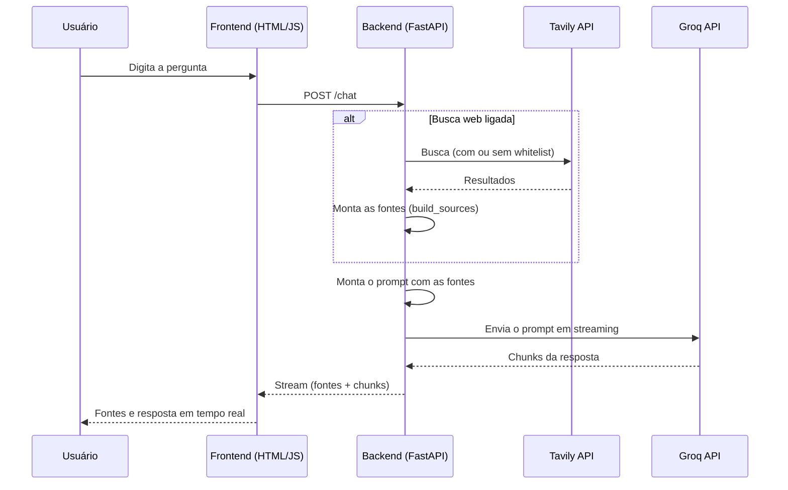

# Busca IA (Busca_web_LLM)

Assistente de pesquisa conversacional: pesquisa na web em tempo real, sintetiza a resposta com um LLM e mostra as fontes citadas, com respostas em streaming.

> **EN:** Conversational research assistant. It searches the web in real time (Tavily), streams a synthesized answer from Llama 3.3 70B (Groq) and shows the cited sources with favicons and inline citations. Optional whitelist restricts searches to trusted domains.

## O que ele faz

- **Busca web em tempo real** com Tavily, para respostas com informação atual.
- **Respostas com fontes**: cada resposta mostra as fontes (título, domínio e favicon) e usa citações inline.
- **Whitelist de domínios confiáveis**: opção para restringir a busca a sites de imprensa e esporte confiáveis. Se a busca restrita não retornar nada, o app faz fallback para busca aberta.
- **Streaming** da resposta, com renderização de Markdown (negrito, listas, código).
- **Controles na interface** para ligar e desligar a busca web e a whitelist.

## Como funciona



### Decisões de projeto

- **Busca antes da geração (RAG simples).** Os snippets das fontes entram no prompt, então a resposta se apoia em conteúdo recente em vez de só no conhecimento do modelo.
- **Fontes enviadas antes do texto.** O stream manda primeiro as fontes e depois os chunks, e a interface já mostra de onde a resposta vem enquanto ela é escrita.
- **Fallback da whitelist.** Restringir domínios melhora a confiabilidade, mas pode zerar os resultados. Nesse caso a busca aberta assume.

## Stack

| Camada | Tecnologia |
|---|---|
| Backend | Python, FastAPI, Uvicorn, httpx |
| Busca web | Tavily |
| LLM | Groq, modelo `llama-3.3-70b-versatile` (temperatura 0.7, até 1024 tokens) |
| Frontend | HTML, CSS e JavaScript puro com templates Jinja2 |

## Como rodar

```bash
git clone https://github.com/igortavaresalves/Busca_web_LLM.git
cd Busca_web_LLM

python -m venv venv
source venv/bin/activate        # Windows: venv\Scripts\activate
pip install -r requirements.txt

cp env.example .env             # Windows: copy env.example .env
```

Preencha o `.env`:

```
GROQ_API_KEY=...      # https://console.groq.com
TAVILY_API_KEY=...    # https://app.tavily.com (1.000 buscas por mês no plano gratuito)
```

Suba o servidor e acesse http://localhost:8000:

```bash
uvicorn app:app --reload
```

## Endpoints

| Método | Rota | Descrição |
|---|---|---|
| `GET` | `/` | Interface web |
| `POST` | `/chat` | Pergunta e resposta em streaming, com fontes |
| `POST` | `/toggle_web` | Liga ou desliga a busca web |
| `POST` | `/toggle_whitelist` | Liga ou desliga a restrição de domínios |
| `GET` | `/whitelist` | Lista os domínios confiáveis |
| `GET` | `/status` | Estado da aplicação e das chaves configuradas |

## Estrutura

```
Busca_web_LLM/
├── app.py                # backend FastAPI
├── requirements.txt
├── env.example           # modelo de variáveis de ambiente
└── templates/
    └── index.html        # interface web
```

## Limitações e próximos passos

- Os interruptores de busca web e whitelist são globais no servidor: mover o estado para a sessão do usuário.
- Sem memória de conversa: enviar o histórico ao modelo para perguntas de acompanhamento.
- Sem testes automatizados: cobrir `build_sources` e o fallback da whitelist.
- Containerizar com Docker para facilitar a execução.

## Autor

Igor Tavares, desenvolvedor backend e de soluções com IA, Recife (PE). [GitHub](https://github.com/igortavaresalves)
